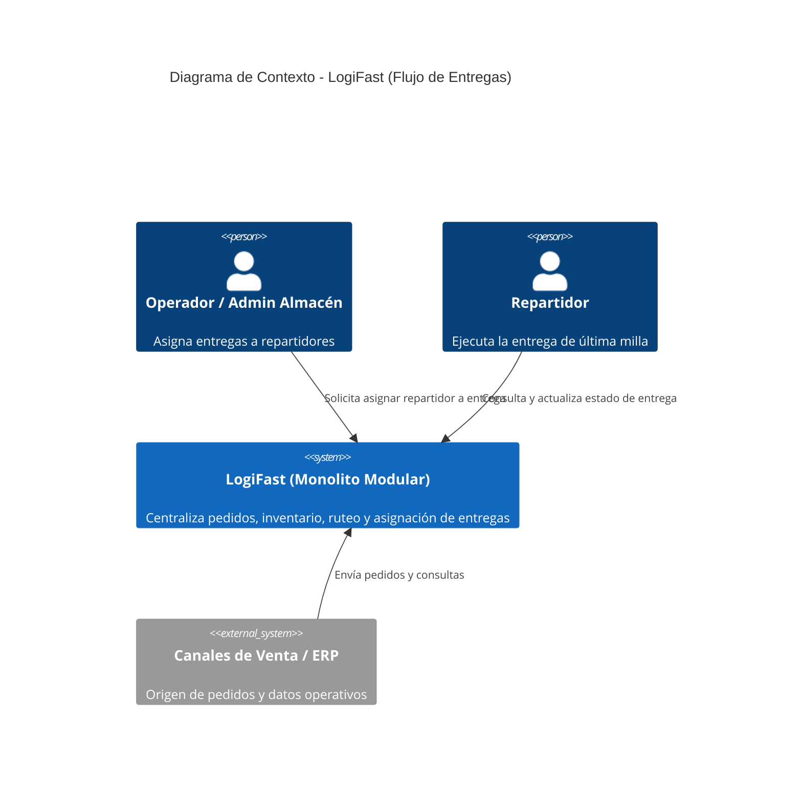
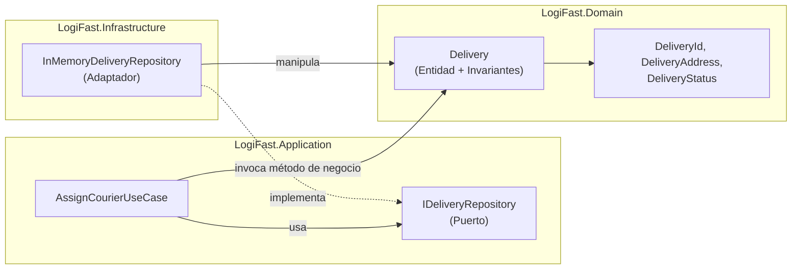

# LogiFast — Architecture.md

## 1. Propósito y Alcance de la Iteración
Esta documentación refleja el diseño arquitectónico y de dominio de **LogiFast** para el flujo acotado de **asignación de repartidor a una entrega de última milla (`AssignCourierUseCase`)**, construido sobre la base del **Monolito Modular** definido en la Actividad 2.

---

## 2. Contextos Delimitados (Bounded Contexts) y Contratos
* **Pedidos (Ordering):** Recepción multicanal de órdenes y preparación para despacho.
* **Inventario (Inventory):** Control de existencias y bloqueo atómico en almacenes distribuidos.
* **Entregas y Ruteo (Delivery & Routing):** Gestión del ciclo de vida de la entrega, asignación de repartidores (`AssignCourier`) y seguimiento de última milla.

**Intercambio entre contextos:** Los contextos no comparten entidades internas directamente; intercambian información mediante contratos/DTOs explícitos y consultas o eventos acotados (por ejemplo, disponibilidad de reparto separada de la disponibilidad de stock).

---

## 3. Capas y Dirección de Dependencias
* **`LogiFast.Domain` (Núcleo):** Entidades (`Delivery`), objetos de valor (`DeliveryId`, `DeliveryAddress`), estados (`DeliveryStatus`) e invariantes. **No depende de ninguna otra capa.**
* **`LogiFast.Application`:** Casos de uso (`AssignCourierUseCase`) y puertos (`IDeliveryRepository`). **Depende únicamente de `LogiFast.Domain`.**
* **`LogiFast.Infrastructure`:** Adaptadores concretos (`InMemoryDeliveryRepository`, futura persistencia y conectores externos). **Depende de `LogiFast.Application` y `LogiFast.Domain`.**

---

## 4. Diagrama C4 (Contexto, Contenedores y Componentes del Flujo)

### Nivel 1 y 2 — Contexto y Contenedores (Monolito Modular LogiFast)

### Nivel 3 — Componentes del Flujo `AssignCourier`

